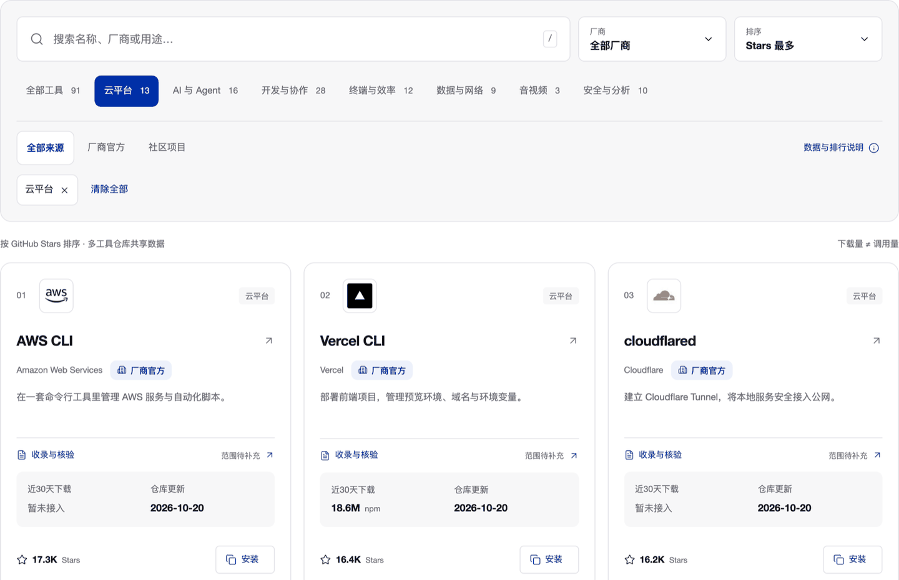

<h1 align="center">SuperCLI</h1>

<p align="center">
  <strong>人工收录 94 个 CLI，公开核验范围，不编造数据。</strong><br>
  厂商官方 40 · 社区项目 54 · 7 个用途分类 · 中英双语
</p>

<p align="center">
  <a href="https://supercli.site"></a>
  <a href="https://github.com/webkubor/supercli/releases"></a>
  <a href="https://github.com/webkubor/supercli/actions/workflows/deploy.yml"></a>
  <a href="https://github.com/webkubor/supercli"></a>
  <a href="LICENSE"></a>
  <a href="README.en.md"></a>
</p>

## 为什么是 SuperCLI

命令行生态的问题不是缺工具，是**缺一个能信的选择入口**。搜索结果混着广告、付费推广和过期教程；排行榜只给一个 Stars 数字，不告诉你这个数意味着什么、什么时候取的、能不能复制。

SuperCLI 的做法是**人工收录 + 公开依据**：

- **每个工具有来源** — 官方仓库、官方文档、维护者原始出处都能追溯
- **排名口径写清楚** — 按 GitHub 仓库 Stars 排，页面标出快照时间，monorepo 指标覆盖整个仓库
- **核验范围公开** — 记录实际核验到哪一步，不给"通过 / 不通过"的伪结论
- **厂商与社区同一套标准** — 标签表示维护来源，不表示质量排名

> Stars 代表仓库关注度，不代表 CLI 调用量、安装量或使用人数。

## 它解决什么问题

| 你的场景 | SuperCLI 怎么做 |
| --- | --- |
| 知道有哪些工具，不确定选哪个 | 7 个用途分类，搜索 + 厂商 + 排序组合筛选 |
| 看到工具名，不确定靠不靠谱 | 厂商官方 / 社区项目标签 + 可展开的收录与核验记录 |
| 找到了，但装不上 | 官方安装命令一键复制，来源与限制写在同一处 |
| 想收藏一组筛选结果 | 筛选状态写进 URL，刷新和分享都还原 |
| 不知道该装什么 | 三个场景指南：AI 编程选型 / 云端部署 / 终端效率组合 |


<details>
<summary>展开看界面与收录分布</summary>

**目录筛选**——分类、厂商、排序可组合，筛选状态同步 URL。



**工具详情**——点开任一工具，给出用途、来源、指标口径、安装命令和收录记录。


**收录分布**（94 个工具）

| 分类 | 数量 | 示例 |
| --- | --- | --- |
| 开发与协作 | 29 | gh · git · pnpm · uv · facet |
| AI 与 Agent | 17 | claude · codex · gemini · ollama · claude-usage-statusline |
| 云平台 | 13 | wrangler · vercel · supabase · firebase |
| 终端与效率 | 12 | fzf · bat · fd · zoxide |
| 安全与分析 | 10 | nmap · nuclei · sqlmap · frida |
| 数据与网络 | 9 | jq · httpie · rclone · wget |
| 音视频 | 4 | ffmpeg · sox · whisper · reel-kit |

</details>

## 怎么参与

**不用写代码** — 填一张表单：

- [推荐一个 CLI](https://github.com/webkubor/supercli/issues/new?template=cli.yml) · [修正已有信息](https://github.com/webkubor/supercli/issues/new?template=correction.yml)

**熟悉 Git** — 提 PR：

1. Fork 后修改 `data/catalog.json`（收录真源）
2. 图标放入 `public/icons/`，来源登记在 `docs/ICONS.md`
3. 补 `data/community.json` 收录记录与 `data/reviews.json` 核验记录
4. 跑 `pnpm build` 后开 PR，说明来源、用途和推荐理由

细节见 [CONTRIBUTING.md](CONTRIBUTING.md) 与 [公开收录标准](https://supercli.site/standards)。

**审核流程**：Issue 进入待核验 → 维护者本地核验来源、安装与图标 → 人工审核 → 手动合并 → 自动发布。没有自动审核、自动批准或定时任务。推荐者署名需明确同意，可在原 Issue 撤回。

## 本地运行

需要 Node 24+ 与 pnpm 12.4。

```sh
git clone https://github.com/webkubor/supercli.git
cd supercli
pnpm install --frozen-lockfile
pnpm dev
```

```sh
pnpm build      # 类型检查 + 数据校验 + 行为回归测试 + 构建
pnpm test       # 行为与安全回归
pnpm typecheck  # 严格类型检查
```

刷新数据快照（需本机已登录 `gh`）：

```sh
node scripts/sync.mjs --gh --icons   # GitHub 指标与官方组织图标
pnpm sync:usage                       # npm 近 30 天下载量
```

## 透明与边界

- **数据来源**：[docs/SOURCES.md](docs/SOURCES.md) · [docs/RESEARCH.md](docs/RESEARCH.md)
- **收录与核验标准**：[supercli.site/standards](https://supercli.site/standards)
- **人工审核机制**：[docs/REVIEW.md](docs/REVIEW.md)
- **品牌与设计规范**：[supercli.site/brand](https://supercli.site/brand) · [DESIGN.md](DESIGN.md) · [EXPERIENCE.md](EXPERIENCE.md)
- **图标来源**：[docs/ICONS.md](docs/ICONS.md)
- **配置与 FAQ**：[docs/CONFIGURATION.md](docs/CONFIGURATION.md) · [docs/FAQ.md](docs/FAQ.md) · [SECURITY.md](SECURITY.md)
- **变更记录**：[CHANGELOG.md](CHANGELOG.md) · [Releases](https://github.com/webkubor/supercli/releases)

商标与图标归各权利人，本站为独立社区项目，不代表任何厂商背书。MIT 许可仅覆盖本站原创代码。

---

<p align="center">
  <a href="https://supercli.site"><strong>supercli.site</strong></a> ·
  <a href="https://github.com/webkubor/supercli/issues/new?template=cli.yml"><strong>推荐一个工具</strong></a> ·
  <a href="https://github.com/webkubor/supercli"><strong>Star</strong></a>
</p>
